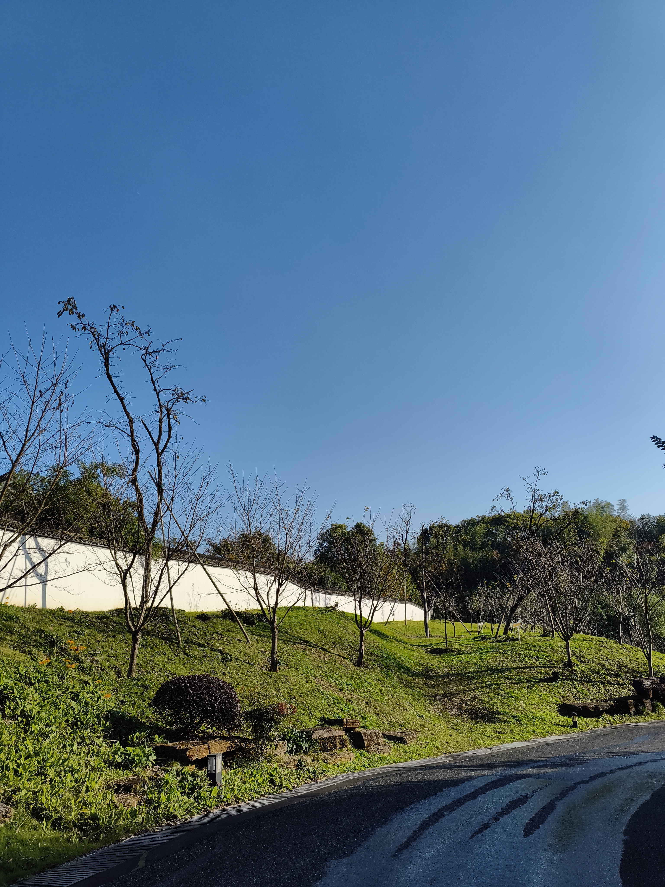

# Capture-authentic-photos
This is my first repository as a new GitHub user. Because I'm not very confident in my programming skills yet, I chose to start by creating a repository to store photos, using it to practice using GitHub. These photos may not be aesthetically pleasing, and they lack any composition or concepts of foreground and background, but they were taken by a real human hand and are absolutely authentic.

If the world is destroyed by nuclear war in the future, or if technological advancements allow humanity to navigate the cosmos, humans in underground bunkers or spaceships might only be able to see scenes of Earth's past through their imagination. If you, by any chance, come across this GitHub repository, please remember that all the photos here were taken by a real human, and they depict places that truly existed on Earth...

